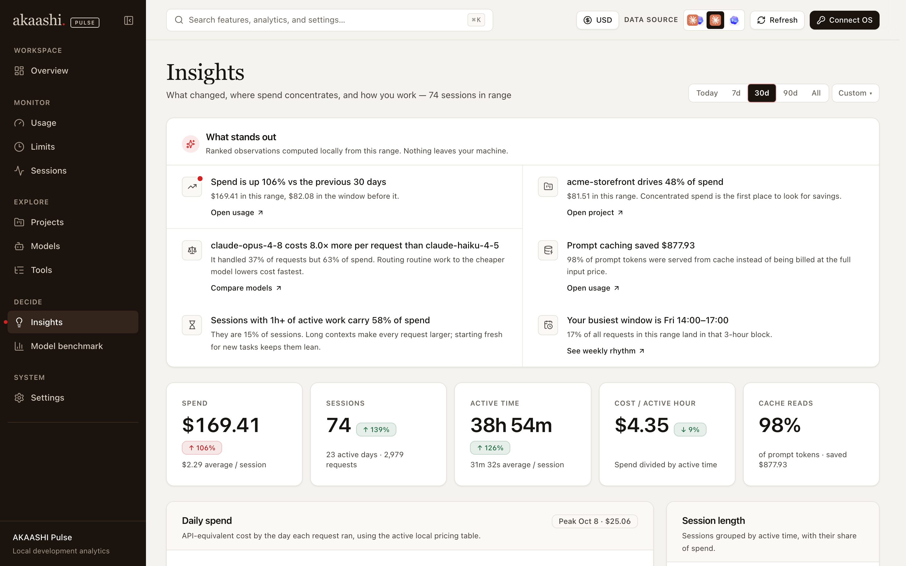
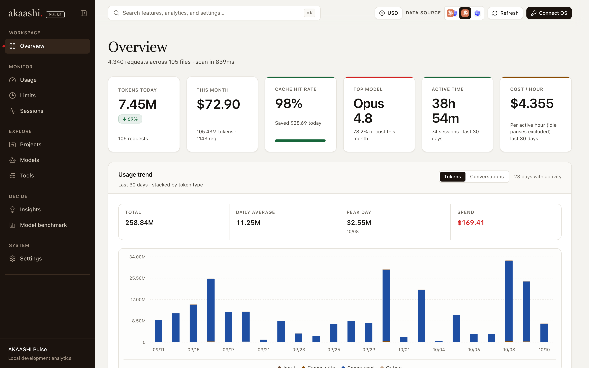
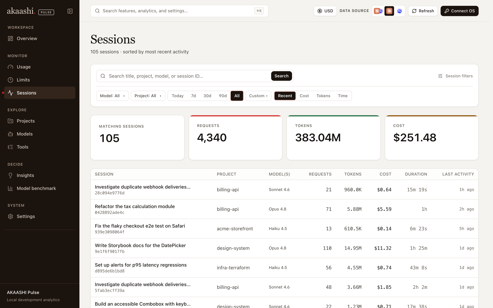
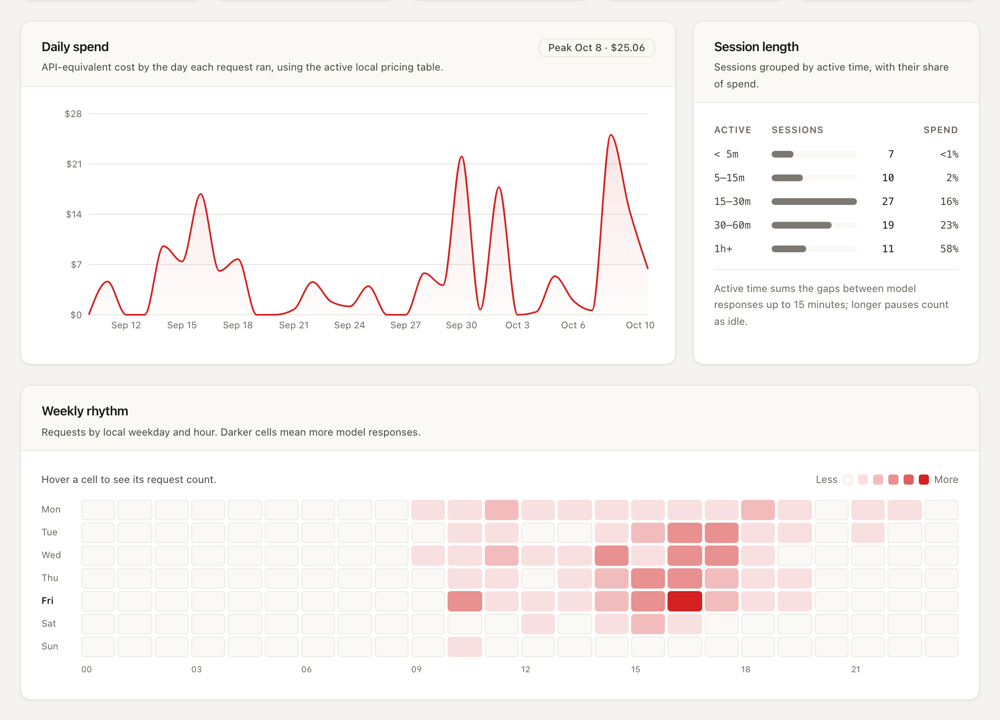
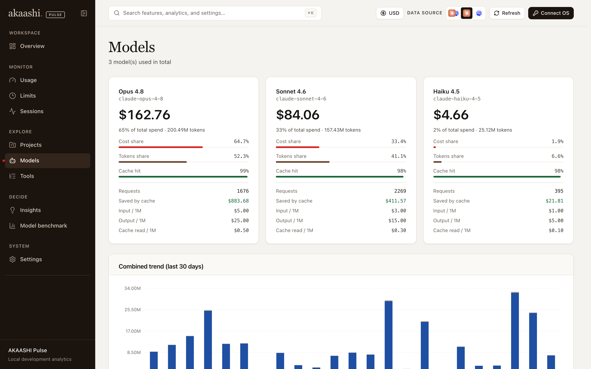
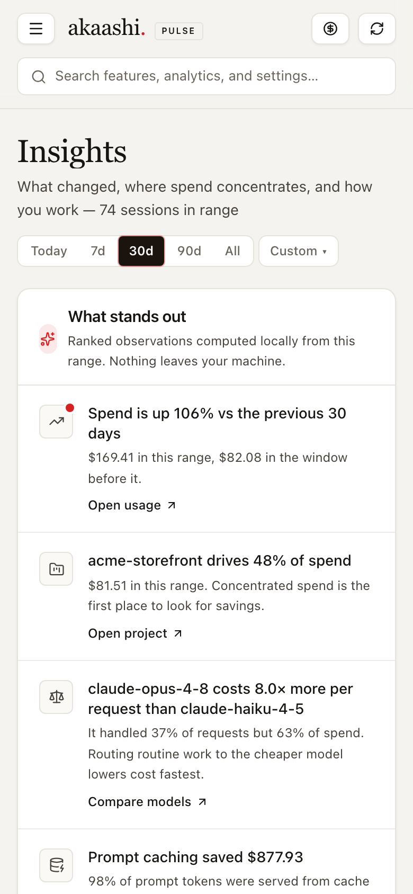
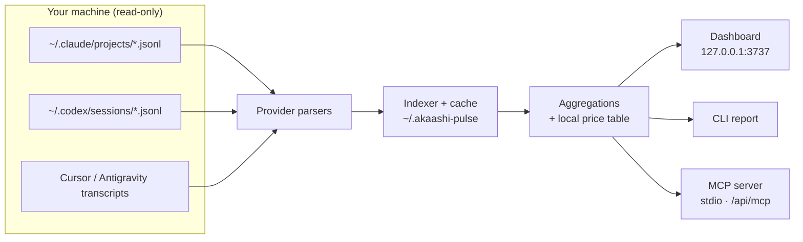

<div align="center">


# AKAASHI Pulse

**Local-first analytics for AI coding agents.**
See what Claude Code, Codex CLI, Cursor, and Antigravity cost you, where the spend goes, and how you actually work — without your prompts or code ever leaving your machine.

[](https://github.com/jordaoqualho/akaashi-pulse/actions/workflows/ci.yml)
[](CHANGELOG.md)
[](LICENSE)
[](https://nodejs.org/)
[](https://pnpm.io/)
<br />
[](https://nextjs.org/)
[](https://react.dev/)
[](https://www.typescriptlang.org/)
[](#mcp-server)
[](#privacy)
[](CONTRIBUTING.md)

[Quick start](#quick-start) · [Features](#features) · [Screenshots](#screenshots) · [CLI](#cli) · [MCP](#mcp-server) · [Configuration](#configuration) · [Contributing](CONTRIBUTING.md)

<br />



</div>

## Why Pulse?

AI coding agents write detailed JSONL logs on your disk, but those logs are hard to reason about. Pulse indexes them read-only and answers practical questions:

- **What did this cost?** API-equivalent spend per day, project, model, and session, from a committed price snapshot.
- **Where does spend concentrate?** One project, one model, or one runaway session usually explains most of the bill.
- **How do I actually work?** Active time (idle pauses excluded), weekly rhythm, session length, and cache efficiency.
- **Am I near my limits?** 5-hour and weekly account windows, when the agent writes them locally.

Everything runs on `127.0.0.1`. There is no account, no telemetry, and no cloud backend.

## Features

| | |
| --- | --- |
| **Overview** | Today, this month, cache hit rate, top model, and a stacked token trend. |
| **Insights** | Ranked findings (spend change, cost concentration, model premium, cache savings, outlier sessions), active-time KPIs with deltas, daily spend, weekday × hour heatmap. |
| **Usage** | Token and cost breakdown by time, model, and project, with CSV export. |
| **Sessions** | Searchable sessions with turn-by-turn detail, tools used, and per-model cost. |
| **Projects & Models** | Per-project and per-model spend, cache savings, and effective prices. |
| **Model benchmark** | Decision signals from your own logs: lowest observed cost, local workhorse, best cache efficiency. |
| **Limits** | Claude Code and Codex quota windows from supported local telemetry. |
| **Tools & skills** | Estimated context footprint by tool, skill, and MCP server. |
| **CLI report** | Terminal tables and JSON for scripts and CI. |
| **MCP server** | Let an agent query its own usage over stdio or HTTP — read-only. |

### Supported agents

| Agent | Tokens & cost | Activity | Limits | Default location |
| --- | :---: | :---: | :---: | --- |
| Claude Code | ✅ | ✅ | ✅ via status line | `~/.claude/projects/` |
| OpenAI Codex CLI | ✅ | ✅ | ✅ | `~/.codex/sessions/` |
| Cursor | — | ✅ | — | `~/.cursor/projects/**/agent-transcripts/` |
| Antigravity | — | ✅ | — | `~/.gemini/antigravity/brain/` |

Cursor and Antigravity are activity-only until their logs include explicit token usage.

## Screenshots

> All screenshots use synthetic data from `pnpm demo`. No real prompts, paths, or projects.

<table>
  <tr>
    <td width="50%"></td>
    <td width="50%"></td>
  </tr>
  <tr>
    <td align="center"><sub><b>Overview</b> — today, this month, cache hit rate, and token trend</sub></td>
    <td align="center"><sub><b>Sessions</b> — search, filter, and sort every agent session</sub></td>
  </tr>
  <tr>
    <td width="50%"></td>
    <td width="50%"></td>
  </tr>
  <tr>
    <td align="center"><sub><b>Insights</b> — daily spend, session length, weekly rhythm</sub></td>
    <td align="center"><sub><b>Models</b> — cost share, cache savings, and effective prices</sub></td>
  </tr>
</table>

<p align="center">
  
  <br />
  <sub>Responsive down to phone width.</sub>
</p>

## Quick start

**Requirements:** Node.js 20+, [pnpm](https://pnpm.io/) 10, macOS or Linux (Windows works for the dashboard and CLI; the login service is macOS/Linux only).

```bash
git clone https://github.com/jordaoqualho/akaashi-pulse.git
cd akaashi-pulse
pnpm install
pnpm build
node bin/cli.mjs service install   # always-on dashboard → http://127.0.0.1:3737
```

The service runs the prebuilt standalone server, starts at login (launchd on macOS, systemd user unit on Linux), and keeps its index cache in `~/.akaashi-pulse/`, so restarts are fast.

Prefer not to install a service?

```bash
node bin/cli.mjs start             # foreground, opens your browser
node bin/cli.mjs start --background
```

### Try it without your own data

```bash
pnpm demo   # synthetic Claude Code + Codex sessions → http://127.0.0.1:3739
```

`pnpm demo` generates 45 days of realistic, deterministic sessions in `.demo-home/` and runs the dashboard with `HOME` pointed there, so your real logs are never read.

## CLI

```bash
node bin/cli.mjs start | stop | restart | status | open | logs
node bin/cli.mjs service install | status | restart | uninstall
node bin/cli.mjs report --range 30d --by project     # terminal report
node bin/cli.mjs report --range 7d --json            # machine-readable
node bin/cli.mjs mcp                                 # MCP server over stdio
node bin/cli.mjs doctor                              # one-screen diagnostics
```

Run `node bin/cli.mjs <command> --help` for every option. Once the package is linked (`pnpm link --global`), the same commands are available as `akaashi-pulse`.

## MCP server

Pulse exposes read-only usage tools to any MCP client, so an agent can answer “how much did this refactor cost?” on its own.

```bash
# Claude Code
claude mcp add akaashi-pulse -- node /ABSOLUTE/PATH/akaashi-pulse/bin/cli.mjs mcp
```

Tools: `usage_summary`, `usage_by_time`, `usage_by_model`, `usage_by_project`, `usage_by_session`, `daily_summary`, `weekly_summary`, `recent_activity`, `cost_estimator`. The running dashboard also serves the same tools over HTTP at `http://127.0.0.1:3737/api/mcp`. Settings → MCP shows a ready-to-copy config.

## Claude Code limits

Claude Code reports plan limits through its status-line input. Point the status line at the bundled script (absolute path):

```json
"statusLine": {
  "type": "command",
  "command": "node /ABSOLUTE/PATH/akaashi-pulse/scripts/claude-statusline.mjs"
}
```

Pulse never edits `~/.claude/settings.json` for you. After one model response on a Pro/Max plan, Claude writes a sanitized snapshot to `~/.akaashi-pulse/claude-rate-limits.json`, and the Limits page picks it up. The status line prints compact `5h / 7d` percentages and never stores prompts, working directories, or session text. As a fallback, Pulse also reads explicit limit events already present in Claude's JSONL; it never estimates quotas from token totals.

## Configuration

Settings → Providers discovers the standard folders for your OS. You can add more folders there; they are saved in `~/.akaashi-pulse/config.json` and watched read-only.

Project analytics are scoped to `~/Workspaces` (or `~/workspaces`) automatically when that folder exists, so unrelated directories don't show up as projects. Change the roots in Settings → Providers, include every local path, or set `AKAASHI_PULSE_PROJECT_ROOTS`.

| Variable | Purpose |
| --- | --- |
| `AKAASHI_PULSE_STATE_DIR` | Runtime data directory (default `~/.akaashi-pulse`) |
| `AKAASHI_PULSE_CONFIG_DIR` | Extra Claude Code config root (also `CLAUDE_CONFIG_DIR`) |
| `AKAASHI_PULSE_CODEX_DIR` | Codex home (also `CODEX_HOME`) |
| `AKAASHI_PULSE_CURSOR_DIR` | Cursor data root (also `CURSOR_AGENT_HOME`) |
| `AKAASHI_PULSE_ANTIGRAVITY_DIR` | Antigravity data root under `.gemini` |
| `AKAASHI_PULSE_PROJECT_ROOTS` | Comma-separated project roots (also singular `AKAASHI_PULSE_PROJECT_ROOT`) |
| `AKAASHI_PULSE_OFFLINE` | `1` disables the optional LiteLLM price refresh |
| `AKAASHI_PULSE_PRICING_OFFLINE` | Same, for pricing only |
| `AKAASHI_PULSE_PRICING_TTL_MS` | Price overlay cache TTL |
| `AKAASHI_PULSE_DEBUG` | Verbose indexer logging |
| `AKAASHI_PULSE_MCP_PRETTY` | Pretty-print MCP tool JSON |
| `AKAASHI_PULSE_POLL_FALLBACK` | `1` / `0` to force file polling when watchers are unavailable |

## How it works



- **Parsers** turn each agent's JSONL into normalized request records (deduplicated; Codex cumulative counters become per-request deltas).
- **Indexer** watches the folders, caches parsed files on disk, and rescans only files that changed.
- **Pricing** uses a committed LiteLLM snapshot. The dashboard can optionally refresh it; the CLI and MCP always stay offline.
- **Cost is an estimate** of API-equivalent list price, not your invoice. Subscriptions (Pro, Max, Plus) are billed differently.

## Privacy

- Reads existing local session files only, and never writes to them.
- Binds to loopback (`127.0.0.1`) by default.
- Never uploads prompts, responses, file paths, or source code.
- The only network call is the optional price refresh (`AKAASHI_PULSE_OFFLINE=1` turns it off).
- The optional AKAASHI OS integration is **off by default** and, when enabled, sends normalized aggregate metrics only.

Found a privacy or security problem? See [SECURITY.md](SECURITY.md).

## Development

```bash
pnpm dev          # dashboard with hot reload on :3738 (builds into .next-dev)
pnpm demo         # same, on synthetic data, on :3739
pnpm typecheck
pnpm lint
pnpm test         # parsers, pricing, aggregation, guard scripts
pnpm build        # standalone server + MCP + report bundles + smoke test
```

`pnpm dev` and `pnpm demo` use their own build folders, so they never break a running service. After parser or indexer changes, bump the provider `parserVersion` (see `scripts/parser-versions.json`) and restart the service:

```bash
node bin/cli.mjs service restart
```

Read [CONTRIBUTING.md](CONTRIBUTING.md) before opening a pull request, and [AGENTS.md](AGENTS.md) for architecture invariants.

| Path | Role |
| --- | --- |
| `app/` | Next.js App Router pages and HTTP API (including read-only MCP) |
| `components/` | React UI built on the AKAASHI design tokens in `app/globals.css` |
| `lib/providers/` | Claude, Codex, Cursor, and Antigravity adapters |
| `lib/data-loader/` | JSONL scanning, indexing, caching, watchers |
| `lib/aggregator/` | Usage, cost, and activity aggregations |
| `lib/pricing/` | Built-in price snapshot and optional LiteLLM overlay |
| `lib/mcp/` | MCP server and tools |
| `bin/cli.mjs` | CLI, background service, terminal report |
| `scripts/` | Build helpers, test suites, demo data |

## Roadmap

- Token and cost support for Cursor and Antigravity once their logs carry usage.
- Budgets and alerts for spend thresholds.
- Packaged releases on npm (`npx akaashi-pulse`).

Ideas and bug reports are welcome in [issues](https://github.com/jordaoqualho/akaashi-pulse/issues).

## License

[MIT](LICENSE) © Jordão Qualho. Claude, Codex, Cursor, and Antigravity are trademarks of their respective owners; Pulse is an independent project and is not affiliated with them.
